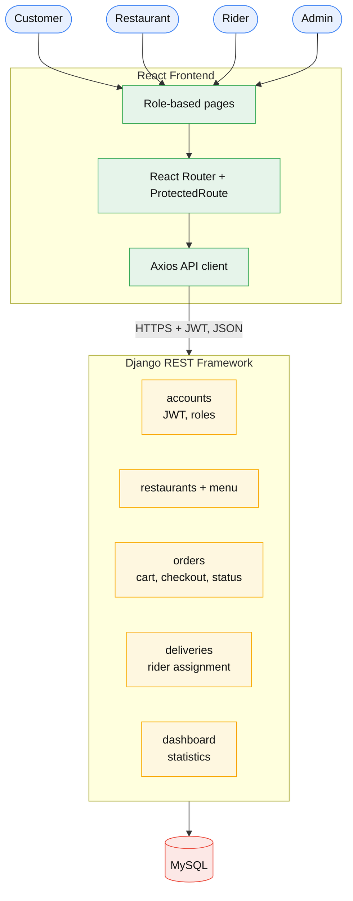
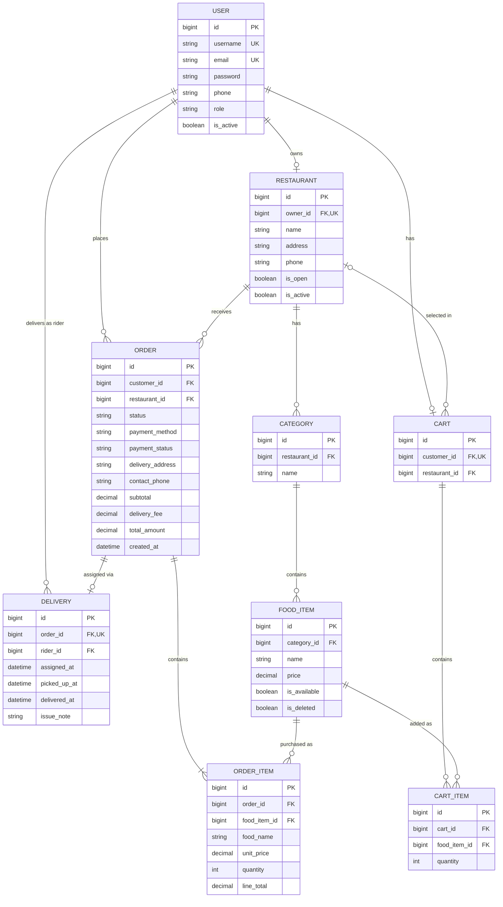
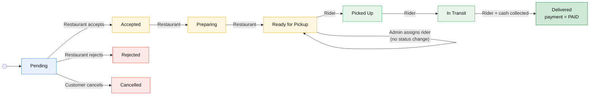
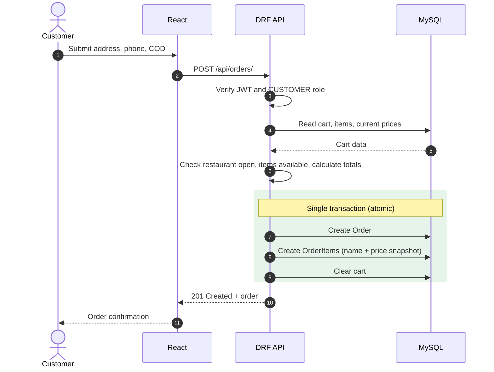
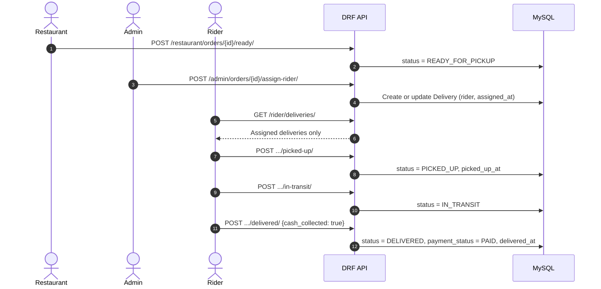
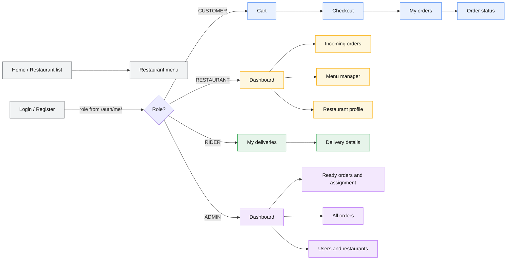

# Food Delivery Ecosystem: Phase 2 Software Design
 
| Item | Value |
|---|---|
| Stack | React, Django REST Framework (DRF), MySQL 8 (InnoDB) |
| Architecture | Modular monolith |
| Team / target | 2 members|
| Input | SRS v1.1 |
| Status | Draft, review with both members before coding |
 
Phase 1 defined **what** the system does. Phase 2 defines **how** it is built. Do not create Django models until the team has agreed on the ERD (Section 3) and the decisions in Section 9.
 
---
 
## 1. Architecture
 
One Django backend split into modules, one React frontend with a dashboard per role. No microservices.
 

 
### Backend modules
 
```text
backend/
├── config/         settings, root urls
├── accounts/       custom User, auth, permissions
├── restaurants/    Restaurant
├── menu/           Category, FoodItem
├── orders/         Cart, CartItem, Order, OrderItem
├── deliveries/     Delivery
└── dashboard/      admin statistics
```
 
| Module | Responsibility |
|---|---|
| `accounts` | Custom user model, register, login, JWT, role permission classes |
| `restaurants` | Restaurant profile, ownership, open/closed state |
| `menu` | Categories and food items |
| `orders` | Cart, checkout, order items, status transitions |
| `deliveries` | Rider assignment, delivery updates, issue reports |
| `dashboard` | Read-only admin statistics |
 
### Team split (suggested)
 
| Member | Owns |
|---|---|
| A | `accounts`, `restaurants`, `menu`, customer pages, restaurant pages |
| B | `orders`, `deliveries`, `dashboard`, rider pages, admin pages |
 
Shared: API contract, permission classes, and the order status service.
 
---
 
## 2. Design Decisions
 
| Topic | Decision |
|---|---|
| User model | One custom user model with `role`: `CUSTOMER`, `RESTAURANT`, `RIDER`, `ADMIN` |
| Account creation | Public registration creates customers only; admin creates restaurant and rider accounts |
| Restaurant ownership | One owner per restaurant, one restaurant per owner (no staff accounts) |
| Menu | Categories belong to a restaurant; food items belong to a category |
| Cart | One cart per customer, tied to one restaurant |
| Different-restaurant item | API returns `409` with a message; customer must clear the cart first |
| Order snapshots | Order stores address and phone; order items store food name and unit price |
| Payment | COD only; `payment_status` is separate from order `status` |
| COD paid | Set to `PAID` when the rider confirms cash collected on delivery |
| Delivery fee | Fixed backend setting, default `0` |
| Delivery tracking | Order `status` is the single source of truth; `Delivery` stores only assignment, timestamps, and issue note |
| Deletion | Food items and restaurants are deactivated, never hard-deleted |
| Money | `DecimalField`, never float |
 
---
 
## 3. Database Design
 
### 3.1 Entity Relationship Diagram
 

 
`PK` primary key, `FK` foreign key, `UK` unique.
 
### 3.2 Tables and Constraints
 
| Table | Key rules |
|---|---|
| `User` | `username` and `email` unique; password hashed by Django; `role` limited to four values |
| `Restaurant` | `owner_id` unique (one restaurant per owner); `name`, `address`, `phone` required |
| `Category` | Unique (`restaurant_id`, `name`) |
| `FoodItem` | `price` > 0; restaurant is derived through Category |
| `Cart` | `customer_id` unique; `restaurant_id` set on first item, cleared when the cart is emptied |
| `CartItem` | Unique (`cart_id`, `food_item_id`); `quantity` >= 1 |
| `Order` | Starts as `status = PENDING`, `payment_status = PENDING`, `payment_method = COD`; totals calculated by the backend |
| `OrderItem` | `quantity` >= 1; `food_name` and `unit_price` are snapshots; `line_total = unit_price x quantity` |
| `Delivery` | `order_id` unique; `rider_id` must reference a user with role `RIDER`; reassignment allowed until the order is Picked Up |
 
Foreign keys use `PROTECT` on `FoodItem`, `Restaurant`, and `User` references from orders so order history is never lost.
 
### 3.3 Relationships
 
| Relationship | Cardinality |
|---|---|
| User (owner) to Restaurant | 1 to 0..1 |
| User (customer) to Cart | 1 to 0..1 |
| User (customer) to Order | 1 to many |
| Restaurant to Category / Order | 1 to many |
| Category to FoodItem | 1 to many |
| Cart to CartItem | 1 to many |
| Order to OrderItem | 1 to 1..many |
| Order to Delivery | 1 to 0..1 |
| User (rider) to Delivery | 1 to many |
 
---
 
## 4. Order Workflow
 
### 4.1 Order Lifecycle
 
Colors show who performs each step.
 

 
| Legend | Actor |
|---|---|
| Blue | Customer |
| Yellow | Restaurant |
| Green | Rider |
| Red / dark green | Terminal states |
 
### 4.2 Allowed Transitions
 
| From | To | Performed by |
|---|---|---|
| Pending | Accepted, Rejected | Restaurant (owner) |
| Pending | Cancelled | Customer (order owner) |
| Accepted | Preparing | Restaurant (owner) |
| Preparing | Ready for Pickup | Restaurant (owner) |
| Ready for Pickup | Picked Up | Assigned rider |
| Picked Up | In Transit | Assigned rider |
| In Transit | Delivered | Assigned rider |
 
Anything else returns `400` (invalid transition) or `403` (not permitted). Put all transition logic in one service function so every endpoint uses the same rules.
 
### 4.3 Payment Status
 
| Method | Initial | Becomes `PAID` when |
|---|---|---|
| Cash on Delivery | `PENDING` | Rider marks Delivered with `cash_collected = true` |
 
If cash could not be collected, the rider marks Delivered without it; payment stays `PENDING` until an admin resolves it.
 
### 4.4 Checkout Sequence
 

 
If any step fails, the transaction rolls back and no partial order is saved.
 
### 4.5 Delivery Sequence
 

 
---
 
## 5. API Design
 
All endpoints are prefixed with `/api/`, use JSON, and require `Authorization: Bearer <token>` unless marked Public.
 
### 5.1 Authentication
 
| Method | Endpoint | Purpose | Access |
|---|---|---|---|
| POST | `/auth/register/` | Register a customer | Public |
| POST | `/auth/login/` | Get access and refresh tokens | Public |
| POST | `/auth/token/refresh/` | Refresh access token | Refresh token |
| POST | `/auth/logout/` | Blacklist refresh token | Authenticated |
| GET | `/auth/me/` | Current user and role | Authenticated |
 
Registration must never create restaurant, rider, or admin accounts.
 
### 5.2 Restaurants and Menu
 
| Method | Endpoint | Purpose | Access |
|---|---|---|---|
| GET | `/restaurants/?search=` | List and search active restaurants | Public |
| GET | `/restaurants/{id}/` | Details with categories and food items | Public |
| PATCH | `/restaurants/my/` | Update own profile, open/closed | Restaurant |
| POST | `/categories/` | Create category | Restaurant |
| POST | `/food-items/` | Create food item | Restaurant |
| PATCH | `/food-items/{id}/` | Update own item or availability | Restaurant |
| DELETE | `/food-items/{id}/` | Soft delete own item | Restaurant |
 
### 5.3 Cart and Customer Orders
 
| Method | Endpoint | Purpose | Access |
|---|---|---|---|
| GET | `/cart/` | View cart | Customer |
| POST | `/cart/items/` | Add item | Customer |
| PATCH | `/cart/items/{id}/` | Change quantity | Customer |
| DELETE | `/cart/items/{id}/` | Remove item | Customer |
| DELETE | `/cart/` | Clear cart | Customer |
| POST | `/orders/` | Checkout | Customer |
| GET | `/orders/` | Own order history | Customer |
| GET | `/orders/{id}/` | Own order details and status | Customer |
| POST | `/orders/{id}/cancel/` | Cancel a Pending order | Customer |
 
### 5.4 Restaurant Orders
 
| Method | Endpoint | Purpose | Access |
|---|---|---|---|
| GET | `/restaurant/orders/` | Own restaurant's orders | Restaurant |
| POST | `/restaurant/orders/{id}/accept/` | Pending to Accepted | Restaurant |
| POST | `/restaurant/orders/{id}/reject/` | Pending to Rejected | Restaurant |
| POST | `/restaurant/orders/{id}/preparing/` | Accepted to Preparing | Restaurant |
| POST | `/restaurant/orders/{id}/ready/` | Preparing to Ready for Pickup | Restaurant |
 
### 5.5 Delivery
 
| Method | Endpoint | Purpose | Access |
|---|---|---|---|
| GET | `/rider/deliveries/` | Own assigned deliveries | Rider |
| POST | `/rider/deliveries/{id}/picked-up/` | Ready to Picked Up | Assigned rider |
| POST | `/rider/deliveries/{id}/in-transit/` | Picked Up to In Transit | Assigned rider |
| POST | `/rider/deliveries/{id}/delivered/` | In Transit to Delivered, body `{cash_collected}` | Assigned rider |
| POST | `/rider/deliveries/{id}/issue/` | Report a problem, body `{note}` | Assigned rider |
 
### 5.6 Administration
 
| Method | Endpoint | Purpose | Access |
|---|---|---|---|
| GET / POST / PATCH | `/admin/users/` | Manage users, create restaurant and rider accounts | Admin |
| GET / PATCH | `/admin/restaurants/` | Manage and activate restaurants | Admin |
| GET | `/admin/orders/?status=&restaurant=` | Monitor all orders | Admin |
| GET | `/admin/riders/` | List riders with active delivery count | Admin |
| POST | `/admin/orders/{id}/assign-rider/` | Assign or reassign rider | Admin |
| GET | `/admin/dashboard/` | Statistics | Admin |
 
### 5.7 API Rules
 
- Use `200`, `201`, `400`, `401`, `403`, `404`, `409` appropriately.
- Error format: `{ "detail": "message" }`, with field errors under `errors`.
- Paginate all list endpoints.
- Never trust prices, totals, user IDs, or roles sent by the client.
- Filter every queryset by the authenticated user, so changing an ID in the URL cannot expose another user's data.
---
 
## 6. Authorization
 
Check **role** first, then **object ownership**.
 
| Action | Rule |
|---|---|
| View restaurants and menus | Public |
| Edit restaurant profile | Owner of that restaurant |
| Manage food items | Owner of the item's restaurant |
| View or edit cart | Cart's customer |
| View or cancel order | Order's customer |
| Process restaurant order | Owner of the order's restaurant |
| Assign rider, view all orders, dashboard | Admin |
| View or update delivery | Assigned rider (admin can view) |
 
Example: a restaurant owner must not be able to edit another restaurant's food item by changing the ID in the URL. Return `404` for objects the user may not see.
 
---
 
## 7. Frontend Design
 
### 7.1 Navigation by Role
 

 
### 7.2 Pages per Role
 
| Role | Pages |
|---|---|
| Public | Home, restaurant list, restaurant menu, login, register |
| Customer | Cart, checkout, my orders, order details/status |
| Restaurant | Dashboard, incoming orders, menu manager (categories and food items), profile |
| Rider | My deliveries, delivery details with status buttons |
| Admin | Dashboard, ready orders and rider assignment, all orders, users, restaurants |
 
### 7.3 Folder Structure
 
```text
frontend/src/
├── api/          client.js (Axios, token handling)
├── components/   Navbar, ProtectedRoute, StatusBadge
├── pages/        auth/ customer/ restaurant/ rider/ admin/
├── context/      AuthContext
└── App.jsx       routes
```
 
### 7.4 Access Control
 
- `ProtectedRoute` redirects users to the dashboard of their own role.
- Show only navigation relevant to the current role.
- Route protection is a convenience only; the backend enforces all permissions.
- Order status updates in the UI must show only the buttons valid for the current status.
---
 
## 8. Technical Rules
 
1. Set `AUTH_USER_MODEL` to the custom user **before the first migration**.
2. Use `DecimalField` for all money values.
3. Use Django's password hashing and a maintained JWT package (for example, `djangorestframework-simplejwt`).
4. Wrap checkout in `transaction.atomic()`.
5. Calculate prices on the backend from current database prices.
6. Validate every status transition on the backend using one shared function.
7. Add database constraints (unique, check) in addition to serializer validation.
8. Never hard-delete restaurants or food items referenced by orders.
9. Keep secrets and database credentials in environment variables.
10. Restrict CORS to the frontend origin.
---
 
## 9. Decisions to Confirm
 
The recommended choices are already applied in this document. The team should confirm or change them before implementation.
 
| # | Decision | Applied choice |
|---|---|---|
| 1 | One restaurant per owner | Yes |
| 2 | Restaurant staff accounts | No, owner only |
| 3 | Who creates restaurant and rider accounts | Admin |
| 4 | Item from a second restaurant | Reject (`409`), clear cart first |
| 5 | Delivery fee | Fixed setting, default `0` |
| 6 | COD marked paid | When the rider confirms cash collected |
| 7 | Cancel after acceptance | Not allowed |
| 8 | Rider updating an unassigned order | Not allowed |
| 9 | Rider capacity for assignment | Admin decides; UI shows active delivery count |
 
Record any change here and update the SRS requirement IDs affected.
 
---
 
## 10. Out of Scope
 
Online payments, live GPS tracking, WebSockets and push notifications, coupons and recommendations, ratings and reviews, advanced analytics and rider earnings, multi-restaurant checkout, and restaurant staff accounts.
 
---
 
## 11. Phase 2 Completion Checklist
 
- [ ] Both members can explain the architecture and module boundaries.
- [ ] ERD reviewed: keys, relationships, and cardinalities agreed.
- [ ] Section 9 decisions confirmed.
- [ ] Order lifecycle, transitions, and payment behavior agreed.
- [ ] API endpoint list and request/response fields agreed.
- [ ] Role and object-level permissions agreed.
- [ ] Low-fidelity wireframes sketched for customer, restaurant, rider, and admin pages.
**Phase 2 is complete when both members can explain, with the tables and endpoints involved, how a customer places an order, how the restaurant processes it, how an admin assigns a rider, and how the rider completes the delivery.**
 
### Next Step
 
Move to Phase 3: project setup, MySQL configuration, custom user model, and JWT authentication. Build in vertical slices (auth, menu, order, delivery, admin) rather than generating all models and pages at once.
 