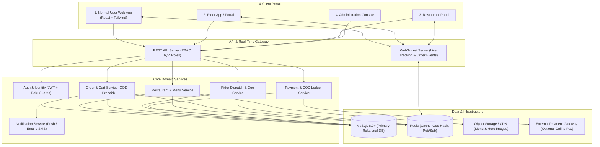
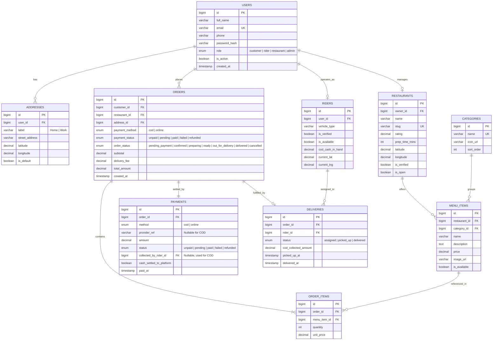
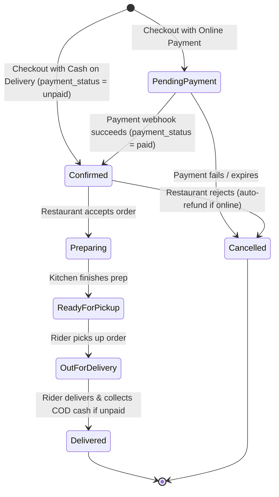
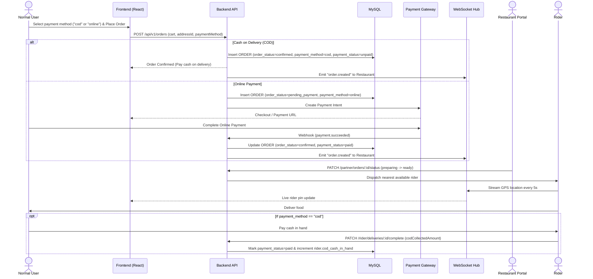

# Foodly — Software Design Document (SDD)

> [!NOTE]
> This document defines the target software architecture, **MySQL** data model, **Cash on Delivery (COD) + Online Payment** flows, APIs, and phased roadmap for **Foodly** (*Food Delivery Ecosystem*), building on the React + Vite + Tailwind CSS frontend in [`frontend/`](../frontend).

---

## 1. System Overview & User Personas (4 User Types)

Foodly is a 4-role food delivery ecosystem:

| User Type | Role Key | Primary Responsibilities | Client Surface |
| :--- | :--- | :--- | :--- |
| **1. Normal User** | `customer` | Browse restaurants & categories, manage cart, choose **Cash on Delivery (COD)** or **Online Payment**, track live delivery, rate orders | Customer Web App (`frontend/`) |
| **2. Rider** | `rider` | Toggle online/offline, accept delivery jobs, stream GPS location, collect **COD cash** at doorstep, mark delivery & cash settlement | Rider Portal / Mobile Web |
| **3. Restaurant Portal** | `restaurant` | Manage store profile, menu items & availability, accept/reject incoming orders (both COD & prepaid), update kitchen prep status | Restaurant Portal |
| **4. Administration** | `admin` | Verify/approve restaurants & riders, manage categories & promos, monitor COD cash settlements, handle disputes & platform analytics | Admin Dashboard |

---

## 2. High-Level System Architecture

---

## 3. Recommended Tech Stack

### Frontend (Already Initialized)
- **Framework**: React 19 + Vite
- **Styling**: Tailwind CSS v4 (`@tailwindcss/vite`)
- **Icons**: `lucide-react`
- **Future Additions**:
  - **Routing**: `react-router-dom` with role-protected routes (`/`, `/login`, `/signup`, `/restaurant/:slug`, `/checkout`, `/rider`, `/partner`, `/admin`)
  - **Server State**: `@tanstack/react-query`
  - **Forms & Validation**: `react-hook-form` + `zod`
  - **Maps**: Leaflet / Mapbox GL JS for delivery address pinning and live rider tracking

### Backend & Database (Future)
- **Database**: **MySQL 8.0+** (InnoDB engine, `DECIMAL(10,2)` for currency, `POINT` spatial columns with `ST_Distance_Sphere` for nearby restaurant & rider queries)
- **Backend API**: Node.js (Express / NestJS with Prisma or TypeORM) **or** Python (FastAPI + SQLAlchemy)
- **Cache & Real-Time**: Redis (cart/session cache, live rider coordinates, WebSocket Pub/Sub)
- **Payments**: Cash on Delivery (COD) built-in + optional Online Payment Gateway (Stripe / SSLCommerz)

---

## 4. MySQL Database Schema (ER Diagram)

---

## 5. Order Lifecycle & Cash on Delivery (COD) Flow

### Order State Machine

### Checkout & Delivery Sequence (Online vs. Cash on Delivery)

---

## 6. Core API Endpoints (Planned)

| Role Access | Method & Endpoint | Purpose |
| :--- | :--- | :--- |
| **Public / All** | `POST /api/v1/auth/register` | Register account (`customer`, `rider`, or `restaurant`) |
| **Public / All** | `POST /api/v1/auth/login` | Authenticate & return JWT + user role |
| **Normal User** | `GET /api/v1/restaurants?lat=&lng=&category=&q=` | Geo-filtered & searchable restaurants via MySQL spatial query |
| **Normal User** | `GET /api/v1/restaurants/:slug/menu` | Restaurant details & available menu items |
| **Normal User** | `POST /api/v1/orders` | Create order with `payment_method: "cod" \| "online"` |
| **Normal User** | `GET /api/v1/orders/:id` | View order status, payment status & live tracking |
| **Restaurant** | `GET /api/v1/partner/orders` | List incoming & active orders for the restaurant |
| **Restaurant** | `PATCH /api/v1/partner/orders/:id/status` | Accept, mark `preparing`, or mark `ready` |
| **Restaurant** | `POST /api/v1/partner/menu-items` | Add/update menu items & toggle availability |
| **Rider** | `PATCH /api/v1/rider/availability` | Go online/offline & update GPS coordinates |
| **Rider** | `PATCH /api/v1/rider/deliveries/:id/complete` | Confirm delivery + record COD cash collected |
| **Admin** | `PATCH /api/v1/admin/restaurants/:id/verify` | Approve/suspend restaurants & riders |
| **Admin** | `POST /api/v1/admin/riders/:id/settle-cod` | Reconcile COD cash collected by a rider |

---

## 7. Security & COD Safeguards

- **4-Role RBAC**: Every API route enforces role middleware (`customer`, `rider`, `restaurant`, `admin`) using JWT access tokens + HTTP-only refresh cookies.
- **Server-Side Pricing**: Totals (`subtotal`, `delivery_fee`, `total_amount`) are always calculated on the server from MySQL `MENU_ITEMS.price`—never trusted from the client.
- **COD Risk & Ledger Controls**:
  - Configurable **max COD order limit** (e.g., orders above a threshold require online payment).
  - **COD Ledger**: `RIDERS.cod_cash_in_hand` tracks unremitted cash; Admin settles it via `settle-cod`, and riders exceeding a cash cap are paused from new COD jobs until settled.
  - **Abuse Prevention**: Accounts with repeated unaccepted/cancelled COD orders can be flagged or restricted to prepaid-only.
- **MySQL Indexing**: Composite indexes on `(customer_id, created_at)`, `(restaurant_id, order_status)`, and spatial indexes on restaurant/address coordinates.

---

## 8. Phased Implementation Roadmap

1. **Phase 1 — Frontend Foundation (Current)**:
   - Landing page (`Navbar`, `Hero`, `PopularCategories`), `Login`, and `SignUp` components in [`frontend/`](../frontend).
2. **Phase 2 — MySQL Database & Auth API**:
   - Set up MySQL 8.0+ schema & migrations, 4-role registration/login endpoints, and connect `Login.jsx` & `SignUp.jsx`.
3. **Phase 3 — Customer Ordering & COD Checkout**:
   - Restaurant listing, menu page, cart persistence, and Checkout supporting **Cash on Delivery** & Online Payment.
4. **Phase 4 — Rider, Restaurant & Admin Portals**:
   - Real-time WebSocket order board for **Restaurant Portal**, GPS & COD collection flow for **Rider**, and verification/COD settlement tools for **Administration**.
