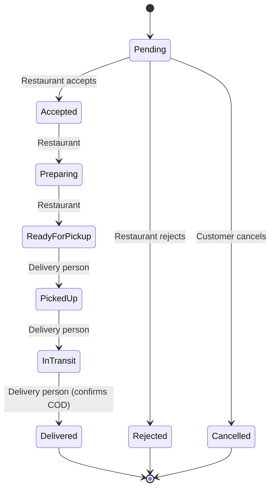
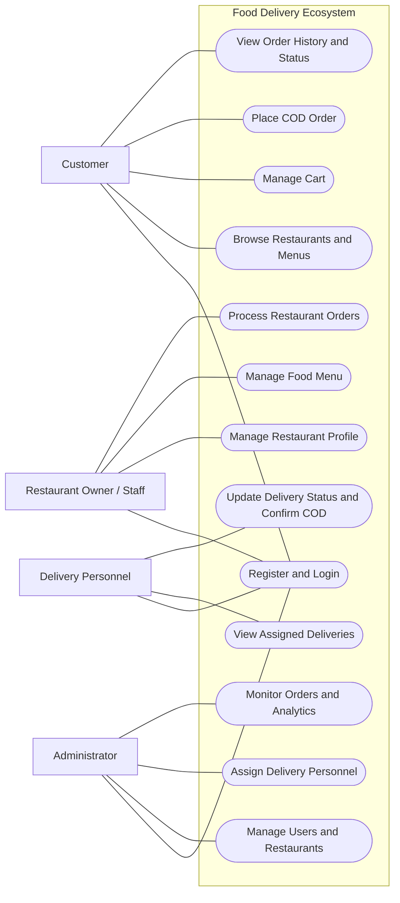

# Software Requirements Specification (SRS)
 
## Food Delivery Ecosystem
 
| Document detail | Value |
|---|---|
| Project | Food Delivery Ecosystem |
| Version | 1.1 (refined) |
| Status | Draft, ready for design and implementation |
| Frontend | React |
| Backend | Django REST Framework (DRF) |
| Database | MySQL |
| Team size | 2 members |
| Initial target | 7-day MVP |
 
### Revision History
 
| Version | Description |
|---|---|
| 1.0 | Initial draft |
| 1.1 | Added glossary, state-transition table, payment and delivery-issue requirements, acceptance criteria, traceability, data entities, API overview, risks, and 7-day plan. Fixed inconsistencies between business rules, use cases, and requirements. |
 
---
 
## 1. Introduction
 
### 1.1 Purpose
 
This document specifies the functional and non-functional requirements of the Food Delivery Ecosystem MVP. It is the reference for design, implementation, testing, and final documentation.
 
### 1.2 Project Overview
 
The Food Delivery Ecosystem is a web-based platform connecting four user groups:
 
- **Customers** browse restaurants, order food, and follow order progress.
- **Restaurants** manage menus and process incoming orders.
- **Delivery personnel** view assigned deliveries and update delivery status.
- **Administrators** manage the platform, assign deliveries, and view statistics.
The goal is a working MVP first, with advanced features added incrementally.
 
### 1.3 Intended Audience
 
Developers, testers, and the course/project supervisor.
 
### 1.4 Definitions and Abbreviations
 
| Term | Meaning |
|---|---|
| MVP | Minimum Viable Product |
| COD | Cash on Delivery |
| JWT | JSON Web Token |
| RBAC | Role-Based Access Control |
| Object-level permission | Check that a user may access a specific record (e.g., only their own restaurant's orders) |
| Order status | Position of the order in the fulfillment lifecycle |
| Payment status | Whether money has been collected; stored separately from order status |
| Available food item | Food item with `is_available = true` belonging to an active restaurant |
| Available delivery person | Active delivery user with no more than N unfinished deliveries (N is configurable; default 3) |
 
---
 
## 2. Project Scope
 
### 2.1 Included in the MVP
 
- Customer, restaurant, delivery personnel, and admin accounts.
- JWT authentication and role-based authorization.
- Restaurant listing, details, and search.
- Restaurant profile and food menu management.
- Cart with items from one restaurant per order.
- Checkout and order placement with Cash on Delivery.
- Restaurant order acceptance, rejection, and preparation updates.
- Admin assignment of delivery personnel.
- Delivery status updates and COD collection confirmation.
- Customer order history and status-based tracking.
- Basic admin analytics.
### 2.2 Excluded from the MVP (Future Enhancements)
 
- Online payment gateways, cards, and digital wallets.
- Live GPS tracking and location waypoint logging.
- Real-time notifications and WebSockets.
- Coupons, discounts, and recommendation systems.
- Reviews and ratings.
- Advanced business intelligence and driver earnings reports.
- Refunds, partial cancellations, and order editing after placement.
---
 
## 3. Stakeholders and User Roles
 
| Role | Main responsibilities |
|---|---|
| Customer | Browse restaurants, manage cart, place orders, track and cancel orders |
| Restaurant owner/staff | Manage restaurant profile, food menu, and incoming orders |
| Delivery personnel | View assigned deliveries, update delivery progress, confirm COD collection |
| Administrator | Manage users and restaurants, assign delivery personnel, monitor orders, view analytics |
 
**Access rule:** Each role may access only the features and data it is authorized to use. Restaurant users manage only their own restaurant's data, and delivery personnel access only their assigned deliveries.
 
---
 
## 4. Functional Requirements
 
Each requirement has a unique ID for traceability across design, implementation, and testing. Items marked **(New)** were added in v1.1 to close gaps found in v1.0.
 
### 4.1 Authentication and User Management
 
| ID | Requirement |
|---|---|
| FR-01 | The system shall allow users to register and log in. Public registration is allowed for Customers only. |
| FR-02 | The system shall support Customer, Restaurant, Delivery Personnel, and Admin roles. |
| FR-03 | The system shall authenticate API requests using JWT (access and refresh tokens). |
| FR-04 | Users shall be able to log out (refresh token is invalidated or discarded). |
| FR-05 | Admin shall be able to create, view, update, and deactivate user accounts. |
| FR-05a **(New)** | Restaurant and Delivery Personnel accounts shall be created by an Admin (or approved by an Admin) and not self-assigned at registration. |
 
### 4.2 Restaurant Management
 
| ID | Requirement |
|---|---|
| FR-06 | Customers shall be able to view available (active) restaurants. |
| FR-07 | Customers shall be able to search restaurants by name (and optionally cuisine/category). |
| FR-08 | Customers shall be able to view restaurant details and menus. |
| FR-09 | Restaurant owners shall be able to create and update their restaurant profile. |
| FR-09a **(New)** | Restaurant owners shall be able to mark their restaurant as open or closed; customers cannot order from a closed or inactive restaurant. |
 
### 4.3 Food and Menu Management
 
| ID | Requirement |
|---|---|
| FR-10 | Restaurant owners shall be able to add, update, and delete food items. |
| FR-11 | Restaurant owners shall be able to manage food name, description, price, and availability. |
| FR-12 | Customers shall be able to order only available food items. |
| FR-12a **(New)** | Deleting a food item that appears in past orders shall be a soft delete so order history remains intact. |
 
### 4.4 Cart and Order Management
 
| ID | Requirement |
|---|---|
| FR-13 | Customers shall be able to add food items to their cart. |
| FR-14 | Customers shall be able to update quantities and remove cart items. |
| FR-15 | A cart/order shall contain items from only one restaurant. If a customer adds an item from another restaurant, the system shall reject it or ask to clear the cart. |
| FR-16 | Customers shall be able to place orders with a delivery address and contact number. |
| FR-17 | The backend shall validate food availability and calculate the order total. |
| FR-18 | Customers shall be able to select Cash on Delivery. |
| FR-19 | Customers shall be able to view their order history and order details. |
| FR-20 | Customers shall be able to cancel an order only while its status is Pending. |
 
### 4.5 Restaurant Order Management
 
| ID | Requirement |
|---|---|
| FR-21 | Restaurant users shall be able to view orders placed with their restaurant. |
| FR-22 | Restaurant users shall be able to accept or reject Pending orders. |
| FR-23 | Restaurant users shall be able to update Accepted orders to Preparing, and Preparing orders to Ready for Pickup. |
| FR-24 | Restaurant users shall be able to manage only their own restaurant's orders. |
 
### 4.6 Delivery Management
 
| ID | Requirement |
|---|---|
| FR-25 | Admin shall be able to assign delivery personnel to orders in Ready for Pickup status. |
| FR-26 | Delivery personnel shall be able to view their assigned deliveries. |
| FR-27 | Delivery personnel shall be able to update delivery status to Picked Up, In Transit, and Delivered, in that order. |
| FR-28 | Customers shall be able to view the current status of their orders. |
| FR-29 | Delivery personnel shall be able to update only their assigned deliveries. |
| FR-29a **(New)** | Delivery personnel shall be able to confirm COD collection when marking an order Delivered; this sets payment status to Paid. |
| FR-29b **(New)** | Delivery personnel shall be able to report a delivery issue (e.g., customer unreachable) with a reason; the report is visible to Admin. |
| FR-29c **(New)** | Admin shall be able to reassign an order to a different delivery person before it is Picked Up. |
 
### 4.7 Administration and Analytics
 
| ID | Requirement |
|---|---|
| FR-30 | Admin shall be able to manage restaurants (create, update, activate/deactivate) and user accounts. |
| FR-31 | Admin shall be able to view and monitor all orders, with filters by status, restaurant, and date. |
| FR-32 | Admin shall be able to view total orders and completed-order revenue. |
| FR-33 | Admin shall be able to view basic order and restaurant statistics (e.g., orders per status, orders per restaurant). |
 
---
 
## 5. Non-Functional Requirements
 
| ID | Category | Requirement |
|---|---|---|
| NFR-01 | Security | The system shall securely hash user passwords (Django default PBKDF2 or stronger). |
| NFR-02 | Security | The system shall use JWT authentication for all protected API endpoints. |
| NFR-03 | Security | The backend shall enforce role-based and object-level permissions. |
| NFR-04 | Security | The backend shall validate all input and never trust prices or totals sent by the frontend. |
| NFR-05 | Reliability | Order creation shall be atomic (database transaction) so an order and its items are saved together or not at all. |
| NFR-06 | Usability | The interface shall be responsive on desktop and mobile screens. |
| NFR-07 | Maintainability | The codebase shall be organized into modular React components and Django apps. |
| NFR-08 | Data integrity | The system shall use MySQL with foreign keys, unique constraints, and not-null constraints. |
| NFR-09 | Security | Secrets and database credentials shall be stored in environment variables, not in source control. |
| NFR-10 **(New)** | Performance | List endpoints (restaurants, orders) shall use pagination; typical responses should return within 2 seconds under MVP load. |
| NFR-11 **(New)** | Usability | API errors shall return consistent JSON with a clear message and appropriate HTTP status code (400, 401, 403, 404). |
| NFR-12 **(New)** | Security | CORS shall be restricted to the frontend origin, and DEBUG shall be off outside development. |
 
---
 
## 6. Business Rules
 
| ID | Rule |
|---|---|
| BR-01 | A customer can place an order from only one restaurant at a time. |
| BR-02 | An order must contain at least one item, and each quantity must be at least 1. |
| BR-03 | The backend validates item availability and calculates prices and totals. |
| BR-04 | The order shall preserve the item name and unit price at the time of purchase. |
| BR-05 | Restaurant users can manage only their own restaurant, menu, and orders. |
| BR-06 | Only an administrator can assign delivery personnel. |
| BR-07 | Delivery personnel can access and update only their assigned deliveries. |
| BR-08 | Customers can cancel an order only while it is Pending. |
| BR-09 | The initial payment method is Cash on Delivery. |
| BR-10 | COD payment is collected at delivery; the delivery person confirms collection when completing the delivery. |
| BR-11 | Order status and payment status are stored separately. |
| BR-12 **(New)** | Order total = sum of (unit price x quantity) for all items. A fixed delivery fee may be added (configurable; default 0 in the MVP). |
| BR-13 **(New)** | Order status can only change through the valid transitions in Section 7.2, and only by the role allowed for that transition. |
| BR-14 **(New)** | Completed-order revenue counts only orders with status Delivered and payment status Paid. |
 
---
 
## 7. Order and Payment Status
 
### 7.1 Order Lifecycle
 
Normal flow:
 
`Pending → Accepted → Preparing → Ready for Pickup → Picked Up → In Transit → Delivered`
 
Alternative terminal states:
 
- `Rejected`: the restaurant rejects a Pending order.
- `Cancelled`: the customer cancels a Pending order.

 
### 7.2 Allowed Transitions
 
| From | To | Allowed role |
|---|---|---|
| Pending | Accepted | Restaurant (owning restaurant) |
| Pending | Rejected | Restaurant (owning restaurant) |
| Pending | Cancelled | Customer (order owner) |
| Accepted | Preparing | Restaurant (owning restaurant) |
| Preparing | Ready for Pickup | Restaurant (owning restaurant) |
| Ready for Pickup | Picked Up | Delivery person (assigned) |
| Picked Up | In Transit | Delivery person (assigned) |
| In Transit | Delivered | Delivery person (assigned) |
 
Any other transition shall be rejected with HTTP 400 (invalid transition) or 403 (not permitted). For example, a restaurant cannot mark an order Delivered.
 
**Note:** Assigning a delivery person does not change the order status. It creates a delivery assignment record on an order that is Ready for Pickup. The delivery person can mark Picked Up only after being assigned.
 
### 7.3 Payment Status (COD)
 
| Status | Meaning |
|---|---|
| Pending | Payment has not been collected. |
| Paid | Delivery person confirmed COD collection. |
 
Payment status is separate from order status. In the normal flow, the delivery person confirms collection while marking the order Delivered, so both change together. If collection cannot be confirmed at that moment, the order may be Delivered with payment Pending until confirmed by the delivery person or Admin.
 
---
 
## 8. Use Case Diagram
 

 
---
 
## 9. Main Use Case Descriptions
 
### UC-01: Customer Places an Order
 
- **Actor:** Customer
- **Preconditions:** Customer is logged in; the cart contains available items from one open restaurant.
- **Main flow:**
  1. Customer browses a restaurant menu.
  2. Customer adds food items to the cart.
  3. Customer proceeds to checkout.
  4. Customer provides a delivery address and contact number.
  5. Customer selects Cash on Delivery and confirms the order.
  6. Backend validates availability and calculates the total.
  7. System creates the order and its order items in one transaction.
- **Alternative flows:**
  - A1: Cart is empty: the system rejects checkout.
  - A2: A food item is unavailable: the system rejects the order and names the item.
  - A3: Invalid address or phone: the system returns validation errors.
- **Postcondition:** Order is saved with order status Pending and payment status Pending; it appears in the customer's history and the restaurant's order list.
### UC-02: Restaurant Processes an Order
 
- **Actor:** Restaurant owner/staff
- **Preconditions:** Restaurant user is logged in; a Pending order belongs to their restaurant.
- **Main flow:**
  1. User views incoming orders.
  2. User accepts the order.
  3. User updates the order to Preparing.
  4. User marks the order Ready for Pickup.
- **Alternative flow:** User rejects the Pending order (optionally with a reason).
- **Postcondition:** Order status is updated and visible to authorized users.
### UC-03: Admin Assigns Delivery Personnel
 
- **Actor:** Administrator
- **Preconditions:** Order is Ready for Pickup and not yet assigned.
- **Main flow:**
  1. Admin views orders ready for delivery.
  2. Admin selects an available delivery person.
  3. Admin assigns the delivery person to the order.
  4. System records the assignment.
- **Alternative flow:** No suitable delivery person is available: the order stays unassigned and visible in the ready list.
- **Postcondition:** The assigned delivery person can view the delivery.
### UC-04: Delivery Personnel Completes a Delivery
 
- **Actor:** Delivery personnel
- **Preconditions:** A delivery is assigned to the logged-in delivery person.
- **Main flow:**
  1. Delivery person views assigned deliveries.
  2. Delivery person picks up the order and sets status Picked Up.
  3. Delivery person sets status In Transit.
  4. Delivery person delivers the food and collects cash.
  5. Delivery person marks the order Delivered and confirms COD collection.
- **Alternative flow:** Delivery cannot be completed: the delivery person reports an issue with a reason; Admin is notified through the admin order view and handles it (reassign or contact customer).
- **Postcondition:** Order status is Delivered and payment status is Paid.
### UC-05: Customer Tracks an Order
 
- **Actor:** Customer
- **Preconditions:** Customer owns the selected order.
- **Main flow:**
  1. Customer opens order history.
  2. Customer selects an order.
  3. System displays the current status, status timestamps, and delivery person name (once assigned).
- **Postcondition:** Customer sees the latest status. (MVP uses page refresh or periodic polling, not real-time push.)
### UC-06: Admin Views Analytics
 
- **Actor:** Administrator
- **Preconditions:** Administrator is authenticated.
- **Main flow:**
  1. Admin opens the dashboard.
  2. System displays total orders, orders by status, completed-order revenue, and per-restaurant order counts.
- **Postcondition:** Admin can view the available platform statistics.
---
 
## 10. Constraints and Assumptions
 
### 10.1 Constraints
 
- Frontend: React. Backend: Django REST Framework. Database: MySQL.
- Initial payment method is Cash on Delivery.
- Delivery tracking is status-based, not GPS-based.
- One order belongs to one restaurant.
- Delivery personnel are assigned by an administrator.
- Seven-day MVP target; production-scale performance and advanced features are out of scope.
### 10.2 Assumptions
 
- Prices are in a single currency (BDT).
- Each restaurant account maps to one restaurant (one owner, one restaurant, in the MVP).
- Delivery address is entered as free text.
- Customers use a modern web browser with internet access.
- Email or SMS verification is not required in the MVP.
---
 
## 11. Data Entities (High-Level)
 
Detailed schema belongs to the Software Design phase.
 
| Entity | Key fields |
|---|---|
| User | id, name, email/phone, password hash, role, is_active |
| Restaurant | id, owner (User), name, description, address, phone, is_active, is_open |
| FoodItem | id, restaurant, name, description, price, is_available, is_deleted |
| Cart / CartItem | id, customer, restaurant, food item, quantity |
| Order | id, customer, restaurant, delivery address, contact number, total, order status, payment method, payment status, timestamps |
| OrderItem | id, order, food item, item name (snapshot), unit price (snapshot), quantity |
| DeliveryAssignment | id, order (one-to-one), delivery person, assigned_by, assigned_at |
| DeliveryIssue | id, order, reported_by, reason, created_at, resolved |
| OrderStatusHistory (optional) | id, order, from_status, to_status, changed_by, changed_at |
 
**Key relationships:** a restaurant has many food items; an order has many order items and belongs to one customer and one restaurant; an order has at most one active delivery assignment.
 
---
 
## 12. API Overview (Suggested)
 
All endpoints are prefixed with `/api/`. Protected endpoints require `Authorization: Bearer <access_token>`.
 
| Area | Endpoints | Access |
|---|---|---|
| Auth | `POST /auth/register`, `/auth/login`, `/auth/refresh`, `/auth/logout` | Public / authenticated |
| Restaurants | `GET /restaurants`, `GET /restaurants/{id}`, `PUT /restaurants/my` | Public / Restaurant |
| Food items | `GET /restaurants/{id}/foods`, `POST/PUT/DELETE /foods` | Public / Restaurant (own) |
| Cart | `GET/POST/PATCH/DELETE /cart` | Customer |
| Orders (customer) | `POST /orders`, `GET /orders`, `GET /orders/{id}`, `POST /orders/{id}/cancel` | Customer (own) |
| Orders (restaurant) | `GET /restaurant/orders`, `POST /restaurant/orders/{id}/status` | Restaurant (own) |
| Delivery (admin) | `POST /admin/orders/{id}/assign`, `GET /admin/orders` | Admin |
| Delivery (driver) | `GET /delivery/orders`, `POST /delivery/orders/{id}/status`, `POST /delivery/orders/{id}/issue` | Delivery (assigned) |
| Admin | `/admin/users`, `/admin/restaurants`, `GET /admin/analytics` | Admin |
 
---
 
## 13. Acceptance Criteria (Key Scenarios)
 
| ID | Scenario | Expected result |
|---|---|---|
| AC-01 | Customer submits an order with a tampered price | Backend ignores the submitted price and uses the stored price. |
| AC-02 | Customer adds items from two restaurants | System blocks the second restaurant's item or requires clearing the cart. |
| AC-03 | Customer cancels an Accepted order | Request is rejected (400). |
| AC-04 | Restaurant A user views or updates Restaurant B's order | Request is denied (403/404). |
| AC-05 | Restaurant user sets an order directly to Delivered | Request is rejected as an invalid transition. |
| AC-06 | Non-admin tries to assign a delivery person | Request is denied (403). |
| AC-07 | Delivery person updates an order not assigned to them | Request is denied (403/404). |
| AC-08 | Order delivered with COD confirmed | Order status = Delivered, payment status = Paid, revenue includes the order. |
| AC-09 | Item price changes after an order is placed | The existing order keeps its original name and unit price. |
| AC-10 | Order creation fails midway | No partial order or order items remain in the database. |
| AC-11 | Request without a valid JWT to a protected endpoint | Response is 401. |
 
---
 
## 14. Requirements Traceability (Summary)
 
| Use case | Related requirements |
|---|---|
| UC-01 Place order | FR-13 to FR-18, FR-12, BR-01 to BR-04, NFR-04, NFR-05 |
| UC-02 Process order | FR-21 to FR-24, BR-05, BR-13 |
| UC-03 Assign delivery | FR-25, FR-29c, BR-06 |
| UC-04 Complete delivery | FR-26, FR-27, FR-29, FR-29a, FR-29b, BR-07, BR-10 |
| UC-05 Track order | FR-19, FR-28 |
| UC-06 Analytics | FR-31 to FR-33, BR-14 |
 
---
 
## 15. Risks and Mitigation
 
| Risk | Impact | Mitigation |
|---|---|---|
| Seven days is tight for two people | Missed features | Build in vertical slices (auth, then menu, then order, then delivery, then admin); cut analytics detail first. |
| Complex permissions cause bugs | Security issues | Write reusable DRF permission classes and test them early. |
| Invalid status transitions | Inconsistent data | Centralize transition logic in one service function with a transition table. |
| Frontend and backend drift | Integration delays | Agree on the API contract (Section 12) on day 1. |
 
---
 
## 16. MVP Plan
 
| Day | Focus |
|---|---|
| 1 | Design: ER diagram, schema, API contract, wireframes; project setup |
| 2 | Backend: users, JWT, roles, permissions; React auth pages |
| 3 | Restaurants and food menu (backend and frontend) |
| 4 | Cart and order placement with transactions |
| 5 | Restaurant order processing; admin assignment; delivery updates |
| 6 | Customer tracking; admin dashboard; integration fixes |
| 7 | Testing, bug fixes, documentation, demo preparation |
 
---
 
## 17. Future Enhancements
 
- Online payment gateway integration.
- Live GPS delivery tracking.
- Real-time notifications using WebSockets.
- Customer reviews and ratings.
- Coupons and promotional offers.
- Advanced restaurant and sales analytics.
- Food recommendation features.
- Refund and order-edit workflows.
---
 
## 18. Implementation Reference
 
| Development phase | Main output |
|---|---|
| Software Design | ER diagram, database schema, class and sequence diagrams, wireframes |
| Backend | Django apps, models, serializers, APIs, permissions |
| Frontend | React pages, components, routing, API integration |
| Testing | API tests, integration tests, test cases and reports |
| Finalization | User manual, installation guide, final SRS and SDD |
 
**Document maintenance:** If the team changes an agreed requirement, update this document and the requirement ID before or alongside implementation.
 